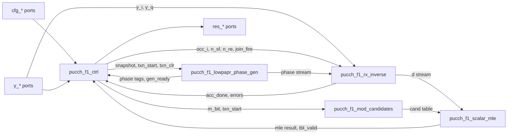

# pucch_f1_rx_core – Specification / Đặc tả
Type: top · Parent: – · Level: L0

## Project overview / Tổng quan dự án

The core receives the PUCCH Format 1 data REs `Y_hat` of one PRB from an external RE Extraction block (the resource grid was already channel-estimated and equalized upstream), removes the low-PAPR base, cyclic-shift and OCC phase with a single CORDIC rotation per RE, coherently sums all REs of both hops, corrects the CORDIC gain and divides by `N_RE` to form one complex estimate `d_rx(0)`, then selects among 2 (`M_bit=1`) or 4 (`M_bit=2`) modulation candidates by maximum scalar correlation. One transaction (one config) produces exactly one result record (success or error). Scope: FR1, normal CP, μ=1 (20 slots/frame), 4..14 PUCCH symbols, no hopping or intra-slot hopping, one context at a time.

_VI:_ Core nhận các data RE `Y_hat` của PUCCH Format 1 trên một PRB từ khối RE Extraction bên ngoài (resource grid đã được channel estimation và equalization ở upstream), loại pha base low-PAPR, cyclic shift và OCC bằng đúng một lần quay CORDIC cho mỗi RE, cộng coherent tất cả RE của cả hai hop, bù gain CORDIC và chia cho `N_RE` để tạo một ước lượng phức `d_rx(0)`, rồi chọn trong 2 (`M_bit=1`) hoặc 4 (`M_bit=2`) candidate modulation theo correlation vô hướng lớn nhất. Một transaction (một config) tạo đúng một result record (thành công hoặc lỗi). Phạm vi: FR1, normal CP, μ=1 (20 slot/frame), 4..14 symbol PUCCH, không hopping hoặc intra-slot hopping, mỗi lúc một context.

Clock / reset: single clock `clk`, rising edge, used by all inputs and outputs. Reset `rst_n` is **synchronous active-low** (input 04 §1, F14); every per-transaction state (snapshot valid, join, pipeline valids, sums, candidate table, result, error) is cleared; constant ROMs are not reset. No CDC inside the core. Reference clock 122.88 MHz (not a timing-closure claim).

_VI:_ Clock / reset: một clock `clk`, sườn lên, dùng cho mọi input và output. Reset `rst_n` **đồng bộ, tích cực mức thấp** (input 04 §1, F14); mọi trạng thái theo transaction (snapshot valid, join, valid của pipeline, tổng, bảng candidate, result, error) bị xóa; ROM hằng không reset. Không có CDC trong core. Clock tham chiếu 122.88 MHz (không phải tuyên bố timing closure).

Decomposition rationale: the input freezes four compute blocks with separate ownership (F01) – low-PAPR generator, RX inverse, modulation candidates, scalar MLE – plus a support controller. Inside the generator the Gold generator is a separate leaf because it is instantiated twice (group hopping and cyclic shift). Inside RX inverse the CORDIC (16 identical pipeline stages) and the normalizer (multiply + sequential divider) are separate leaves so the RX inverse own logic stays readable.

_VI:_ Lý do phân rã: input đã chốt bốn khối tính toán với ownership riêng (F01) – low-PAPR generator, RX inverse, modulation candidates, scalar MLE – cộng một controller hỗ trợ. Trong generator, Gold generator là leaf riêng vì được instance hai lần (group hopping và cyclic shift). Trong RX inverse, CORDIC (16 stage pipeline giống nhau) và normalizer (nhân + bộ chia tuần tự) là leaf riêng để logic riêng của RX inverse dễ đọc.

## Function / Chức năng

- Capture all config fields on one `cfg_valid && cfg_ready` handshake; validate; derive `N_SF0`, `N_SF1`, `N_RE`.
  - _VI:_ Capture mọi field config trong một handshake `cfg_valid && cfg_ready`; kiểm tra; suy ra `N_SF0`, `N_SF1`, `N_RE`.
- Generate the per-RE forward phase `r_phase = base + CS` (Gold-derived `u[h]`, `n_cs`), add OCC, negate, rotate each `Y_hat` once, accumulate, normalize to `d_rx`.
  - _VI:_ Sinh pha xuôi theo từng RE `r_phase = base + CS` (`u[h]`, `n_cs` suy từ Gold), cộng OCC, lấy đối, quay mỗi `Y_hat` một lần, tích lũy, chuẩn hóa thành `d_rx`.
- Compute `K` metrics `M_k = d_rx_I·d_k,I + d_rx_Q·d_k,Q`, choose the max (tie → smaller `k`), report best/second metric, gap, `candidate_idx`, packed `uci_bits`, `d_rx`.
  - _VI:_ Tính `K` metric `M_k = d_rx_I·d_k,I + d_rx_Q·d_k,Q`, chọn lớn nhất (bằng nhau → `k` nhỏ hơn), báo metric best/second, gap, `candidate_idx`, `uci_bits` đã đóng gói, `d_rx`.
- Any invalid config, RE order/marker error, internal alignment error or numeric overflow produces an error record instead of a UCI.
  - _VI:_ Mọi config không hợp lệ, lỗi thứ tự/marker RE, lỗi alignment nội bộ hoặc tràn số tạo error record thay vì UCI.

## Interface

See `doc/spec/interface/pucch_f1_rx_core_interface.md`.

_VI:_ Xem `doc/spec/interface/pucch_f1_rx_core_interface.md`.

## Structure / Cấu trúc

| Instance | Module | Role |
| --- | --- | --- |
| `u_ctrl` | `pucch_f1_ctrl` | Snapshot, FSM, checks, error, result record |
| `u_lowpapr` | `pucch_f1_lowpapr_phase_gen` | Base + CS phase stream per RE |
| `u_rx_inverse` | `pucch_f1_rx_inverse` | OCC, one rotation per RE, coherent sum, normalize |
| `u_mod_cand` | `pucch_f1_mod_candidates` | Candidate table d_k(0) |
| `u_mle` | `pucch_f1_scalar_mle` | Scalar MLE decision |

The top has no glue logic: all external ports go directly to child ports (connections are listed in the `Connects to` column of each child's port table). Outputs `phase_n`, `phase_l_abs`, `cand_phase` and `d_n_re` are debug tags defined by input 04 and are left unconnected at the top.

_VI:_ Top không có glue logic: mọi port ngoài nối thẳng vào port module con (kết nối liệt kê trong cột `Connects to` của bảng port từng module con). Các output `phase_n`, `phase_l_abs`, `cand_phase` và `d_n_re` là tag debug do input 04 định nghĩa và để hở tại top.

### Numeric formats / Định dạng số

| Variable | Format | Width | Derived from | Rounding / saturation |
| --- | --- | --- | --- | --- |
| `y_i`, `y_q` | signed F15 | 16 | Input port | – |
| Phase codes (`r_phase`, base, CS, OCC, remove) | unsigned, 1 turn = 65536 | 16 | 05 LUT | Sum/negate modulo 65536 |
| CORDIC x, y | signed F21 | 24 (25 temp) | `y << 6` | Arithmetic shift; overflow on narrowing → NUMERIC |
| CORDIC z | signed, 1 turn = 2^24 | 24 (25 temp) | `{phase16, 8'b0}` | – |
| CORDIC output | signed F15, gain A16 | 18 | x/64 | RNE, saturate → NUMERIC |
| Accumulator S | signed F15 | 26 | ≤ 84 × 18-bit | Overflow → NUMERIC |
| Product P = S × KINV_Q30 | signed F45 | 57 | 26 × 31 | Full precision |
| Z (gain corrected) | signed F15 | 26 | RNE_div(P, 2^30) | RNE; saturation → NUMERIC |
| `d_rx` | signed F15 | 26 | RNE_div(Z, N_RE) | RNE; saturation → NUMERIC |
| Candidate I/Q | signed F15 (±23170) | 16 | 05 §6 | – |
| Metric product | signed F30 | 42 | 26 × 16 | Exact |
| Metric sum | signed F30 | 43 | 42 + 42 | Exact |
| Metric gap | unsigned F30 | 44 | best − second | Exact, ≥ 0 |

## Behavior / Hành vi

Transaction sequence (FSM in `pucch_f1_ctrl`): IDLE → VALIDATE → PREPARE → RECEIVE → DRAIN → NORMALIZE → DETECT → REPORT → IDLE; an error goes to REPORT with an error record. All streams use `valid && ready` at the rising edge; a producer holds valid and payload while `ready=0`.

_VI:_ Trình tự transaction (FSM trong `pucch_f1_ctrl`): IDLE → VALIDATE → PREPARE → RECEIVE → DRAIN → NORMALIZE → DETECT → REPORT → IDLE; lỗi chuyển sang REPORT với error record. Mọi stream dùng `valid && ready` tại sườn lên; producer giữ valid và payload khi `ready=0`.

Latency (clock edges, excluding external stall) – microarchitecture decisions made in this spec (input F16/F17 leaves them to microarchitecture; the input targets are met):

_VI:_ Latency (số sườn clock, không tính stall bên ngoài) – quyết định vi kiến trúc do spec này chốt (input F16/F17 để cho vi kiến trúc; đạt mục tiêu của input):

| Phase | Latency | Input target |
| --- | --- | --- |
| VALIDATE | 1 clock | – |
| PREPARE (Gold prep, `txn_start` → `gen_ready`) | 1600 + 112·(`slot_idx`+1) + ≤4 clocks; worst ≤ 3844 at slot 19 | ≤ 3904 |
| RECEIVE throughput | 1 RE/clock when `y_valid` is continuous | 1 RE/clock |
| Join → CORDIC output | 18 clocks (join register, stage0, 16 iterations, output stage) | – |
| NORMALIZE (`acc_done` → `d_valid`) | ≤ 30 clocks (1 gain stage + 26 divider iterations + rounding) | ≤ 64 |
| DETECT | 2 clocks (capture `d`, compute + register result) | – |

ROM coding: all ROMs (base 360×16, CS 12×16, OCC 140×16, atan 16×24, modulation 6 entries) are combinational constant ROMs (read latency 0), contents exactly as in `doc/spec/source/07_LUT_Consolidated.md` §2–§7 (OPEN-002). An illegal ROM address returns 0 and raises an error flag (INTERNAL_ALIGN); it never aliases a valid entry.

_VI:_ Mã hóa ROM: mọi ROM (base 360×16, CS 12×16, OCC 140×16, atan 16×24, modulation 6 entry) là ROM hằng tổ hợp (độ trễ đọc 0), nội dung đúng như `doc/spec/source/07_LUT_Consolidated.md` §2–§7 (OPEN-002). Địa chỉ ROM không hợp lệ trả 0 và bật cờ lỗi (INTERNAL_ALIGN); không bao giờ alias vào entry hợp lệ.

Naming: port names follow input 04 exactly (no `_i`/`_o` suffix; `y_q` is the quadrature input, not a register). Internal ports added by this spec use the same style. Arrays of input 04 §7 (`cand_i[0:3]` …) are flattened for Verilog-2005: entry `k` occupies bits `[W*k+W-1 : W*k]`.

_VI:_ Đặt tên: tên port theo đúng input 04 (không hậu tố `_i`/`_o`; `y_q` là input quadrature, không phải thanh ghi). Port nội bộ do spec này thêm dùng cùng kiểu. Mảng ở input 04 §7 (`cand_i[0:3]` …) được flatten cho Verilog-2005: entry `k` chiếm bit `[W*k+W-1 : W*k]`.

## Reset

Synchronous active-low `rst_n`: every child returns to idle, all valids/flags/registers cleared, `cfg_ready=1`, `busy=0`, `res_valid=0`. No stale result is issued after reset.

_VI:_ `rst_n` đồng bộ tích cực mức thấp: mọi module con về idle, xóa mọi valid/cờ/thanh ghi, `cfg_ready=1`, `busy=0`, `res_valid=0`. Không phát result cũ sau reset.
