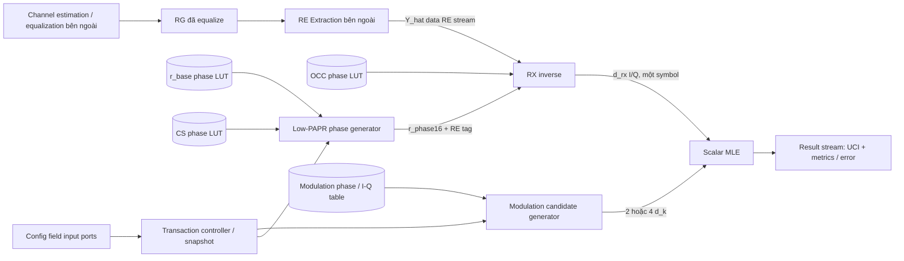

# 02 — Architecture

**Version:** 1.0-vi · **Kiến trúc:** receive inverse phase + scalar candidate MLE.

## 1. Block diagram



## 2. Ownership map

RG mà RE Extraction đọc mặc định đã qua channel estimation/equalization. RE Extraction chọn data RE từ RG đó và giữ convention I/Q khi xuất `Y_hat`. Ba thành phần upstream trong sơ đồ nằm ngoài compute core; không có equalization bổ sung giữa RE Extraction và RX inverse. RX inverse loại pha low-PAPR/CS/OCC còn trên waveform đã equalize, không bù channel lần nữa.

| Module | Sở hữu | Không sở hữu |
|---|---|---|
| `pucch_f1_lowpapr_phase_gen` | Gold state, group hopping, symbol `n_cs`, base ROM, CS remainder, phase `r` | OCC, modulation, RE extraction |
| `pucch_f1_rx_inverse` | Nhận I/Q và phase đúng RE; OCC lookup; tổng pha liên hợp; CORDIC; coherent sum; normalize | Candidate enumeration, bit decision |
| `pucch_f1_mod_candidates` | `M_bit` → K; enumerated bits → phase và I/Q `d_k`; candidate valid mask | Low-PAPR/OCC/CS, waveform expansion |
| `pucch_f1_scalar_mle` | Capture scalar và candidate table; tính metrics, rank, tie và UCI mapping | Channel estimation, derotation |
| Controller hỗ trợ | Snapshot, legality, N_SF/count, expected RE tags, phase/data join, FSM, error abort | Không thêm khối thuật toán thứ năm |

OCC ROM nằm trong RX inverse. Base và CS ROM nằm trong Low-PAPR Gen. Modulation table nằm trong modulation block. Có thể chia vật lý ROM nhưng logical ownership và port contract vẫn như trên.

## 3. Datapath chiều thu

```text
data Y_hat + phase r + tag(q,hop,m,n)
        |
OCC phase lookup(N_SF[hop], cfg_occ_i, m)
        |
theta_remove = -(r_phase + occ_phase) mod 65536
        |
full-circle CORDIC rotation(Y_hat, theta_remove)
        |
18-bit F15 I/Q (gain A16)
        |
26-bit F15 coherent accumulator S_I/S_Q
        |
post-sum inverse-gain correction, then /N_RE
        |
d_rx_I/Q: 26-bit F15 + valid
```

Một RE cần một lần rotation. Không đặt CORDIC base/CS và CORDIC OCC riêng. Không lấy phase của `Y_hat` bằng atan rồi cộng phase trực tiếp: `Y_hat` có biên độ và noise; CORDIC quay vector I/Q ban đầu. Cộng pha chỉ hợp nhất các hệ số unit-magnitude đã biết.

Accumulator xuyên qua hop boundary. Chỉ `m`, `u`, CS/OCC context đổi ở hop, không reset tổng occasion. Cuối cùng chia `N_RE=12*(N_SF0+N_SF1)`; không average từng hop rồi cộng không có weight.

## 4. Scheduling một transaction

| State | Hành động | Exit |
|---|---|---|
| IDLE | `cfg_ready=1`, `y_ready=0` | Nhận config |
| VALIDATE | Kiểm tra ranges, derive N_SF, K, N_RE | Config hợp lệ → PREPARE; lỗi → REPORT |
| PREPARE | Generate Gold/cache `u[hop]`, `n_cs` cho slot; capture candidate table | Hai nhánh sẵn sàng |
| RECEIVE | Join phase với accepted RE, chạy CORDIC và accumulate | Accept RE cuối → DRAIN |
| DRAIN | `y_ready=0`; chờ các token CORDIC đến accumulator | Accumulate token cuối |
| NORMALIZE | Bù gain, chia N_RE, publish `d_rx` | Scalar sẵn sàng |
| DETECT | Tính tất cả K metric, rank | Result register đầy |
| REPORT | `res_valid=1`, giữ payload; `busy=1` | `res_ready=1` → IDLE |

Snapshot là tập flip-flop giữ context khi handshake; không phải Config RAM hay Config Decode của v1.3. Config bên ngoài có thể đổi sau handshake mà không làm đổi transaction.

Một candidate table nhỏ được sinh trong PREPARE và giữ đến DETECT. Scalar chỉ được compare khi đủ cả K candidates. Error trong RECEIVE/DRAIN flush mọi in-flight token và không chạy MLE cho transaction đó.

## 5. Phase/data alignment

Controller giữ một expected counter `q_expected`. Phase request/response và I/Q dùng cùng tag. Không được có `phase_valid` của RE q ghép vào I/Q của RE q+1 khi stall.

Baseline dùng một phase look-ahead register và một join register chứa **cặp** I/Q + phase. Hai stream chuyển vào join cùng một edge: `y_ready=RECEIVE && phase_valid && join_ready`, `phase_ready=RECEIVE && y_valid && join_ready`. Do đó phase handshake và data handshake luôn đồng thời. `q_expected`, CS remainder và RE counters chỉ commit khi cặp sample được nhận; phase look-ahead có thể tính trước nhưng không bỏ token khi sample chưa handshake.

Nếu phase generation được pipelined sâu hơn, bắt buộc FIFO chứa cả payload/tag và phân biệt producer cursor với committed data counter; đây là thay đổi microarchitecture cần kiểm tra. Không tiến Gold/CS bằng clock thuần mà bỏ qua ready/valid. Gold prep có thể chạy tự do trong PREPARE vì chưa có data token.

## 6. Pipeline và timing

Với edge `T` accept vào CORDIC sau phase join, baseline không stall:

| Edge | Stage |
|---|---|
| T | Capture/pre-rotate quadrant, mở rộng I/Q lên F21 |
| T+1 .. T+16 | Micro-rotation j=0..15 |
| T+17 | RNE F21→F15, capture output 18-bit |
| T+18 | Add output vào accumulator |
| T+19 sớm nhất | NORMALIZE có thể dùng final sum đã gồm sample cuối |

Mỗi stage mang `valid`, `q`, `first`, `last`. CORDIC pipeline có global clock-enable: khi output bị stall, toàn bộ stages giữ nguyên. Latency trên là 17 enabled edges đến output, không phải wall-clock cố định trong stall. Accumulator baseline luôn nhận output hợp lệ khi chưa error; handshake ra scalar áp dụng ở NORMALIZE.

RE có thể bị giữ trong phase join nên edge input top-level không nhất thiết trùng `T`. Exact top-level latency và Gold-prep scheduling là deliverable microarchitecture; functional correctness không phụ thuộc latency đó. Không tự tuyên bố bộ spec là timing-closed.

## 7. Storage và resource baseline

| Storage | Logical size | Vai trò |
|---|---:|---|
| Config snapshot | Các field Document 04 | Một context |
| Base phase ROM | 360 × 16 = 5760 bits | `r_base[u][n]` |
| OCC phase ROM | 140 × 16 = 2240 bits | Mọi N_SF=1..7 |
| CS phase ROM | 12 × 16 = 192 bits | Modulo-12 residue to phase |
| CORDIC atan ROM/constants | 16 × 24 = 384 bits | Micro-rotation |
| `n_cs` cache | 14 × 8 = 112 bits | Absolute symbol trong slot |
| `u` cache | 2 × 5 bits | Per hop |
| Candidate table | 4 × (I16+Q16+phase16+bits2+index2+valid1) | Tối đa 4 symbols |
| Accumulator | 2 × 26 bits | One complex sum |
| Join/CORDIC registers | Theo pipeline có tag | Không full RE-vector buffer |

CORDIC thực hiện shift/add; normalization cần constant multiply và integer division một lần/transaction. MLE có tối đa 8 signed multiplications nếu generic parallel arithmetic; có thể dùng dấu/cộng/trừ do candidate I/Q đều ±23170. Không đổi 43-bit canonical metric khi tối ưu.

Các số trên là logical storage, không dự báo LUT/FF/DSP/BRAM sau synthesis. Một integer divider dùng tuần tự hợp lý vì chỉ chạy sau RE cuối; cần chứng minh ngân sách NORMALIZE của yêu cầu performance nếu chọn datapath divider cụ thể.

## 8. Integration sau này

```text
future Config RAM -> decode / field extraction -> current cfg_* ports
external channel estimation/equalization -> RG đã equalize
    -> external RE Extraction -> Y_hat -> current y_* ports
```

`cfg_n_id` là field hiệu lực đã chọn nguồn, không phải packed register. `cfg_slot_idx`, start symbol và hopping dùng để tái tạo phase đúng RE. Starting PRB/second-hop PRB, frame SFN, bandwidth và symbol live không cần cho core arithmetic nên thuộc wrapper/extractor ngoài.
